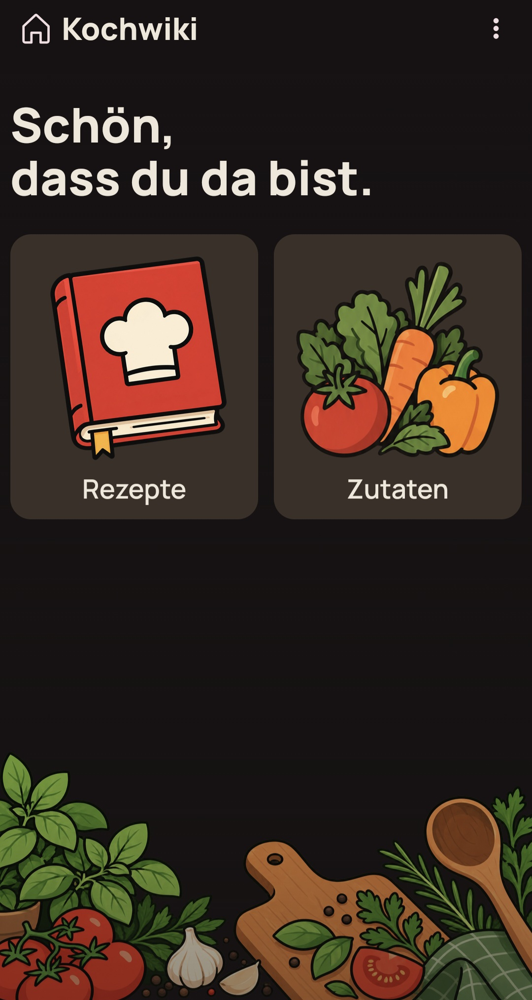

# Kochwiki

Keep your recipes and foodstuffs together, see nutrition per serving, and explore new ideas with AI-assisted recipe improvements.

## Features

- **Recipes that evolve:** organize ingredients and preparation steps, explore drafts, and keep previous versions.
- **A shared foodstuff catalogue:** manage foods, brands, images, and nutrition values for use across recipes.
- **Nutrition per serving:** see energy and macronutrients, with missing values clearly distinguished from zero.
- **AI-assisted improvements:** discuss recipe changes, review suggestions, and save them as drafts. Requires a connected AI service.

## Documentation

See the [documentation overview](docs/README.md) for domain terminology, code navigation, development, operation, and architectural decisions.
