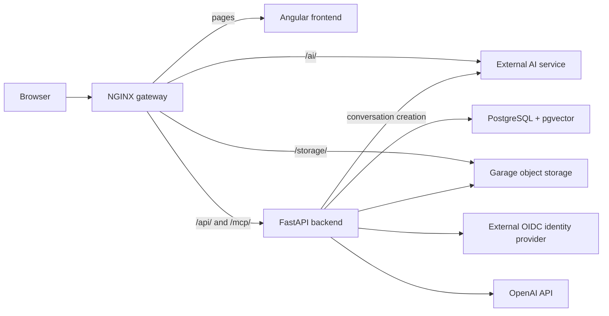

# Repository navigation

Kochwiki manages foodstuffs, versioned recipes, nutrition, and images, with an AI conversation for improving recipes.

## System overview

The gateway routes are defined in [nginx.conf](../deployment/gateway/nginx.conf). The AI service and identity provider live outside this repository; their connections are configured per environment. The backend exposes Model Context Protocol (MCP) tools for recipe and foodstuff operations.

## Code map

| Area | Responsibilities and starting points |
| --- | --- |
| [Frontend](../frontend/src/app/) | Pages, UI state, and HTTP calls. Start with [routes](../frontend/src/app/app.routes.ts); feature code lives under `recipes/` and `foodstuffs/`, shared UI and session handling under `core/`. |
| [Backend](../backend/app/) | Start with [application assembly](../backend/app/main.py) and the [HTTP router](../backend/app/api/router.py). `recipes/` and `foodstuffs/` contain routes, schemas, services, and database models. |
| [Identity](../backend/app/identity/) | OIDC login, application sessions, and users. Frontend session state starts in [ActiveUserService](../frontend/src/app/core/services/active-user.service.ts). |
| [Images](../backend/app/images/) | Shared image metadata, upload validation, and transfers; recipe and foodstuff routes associate images with their records. |
| [Infrastructure](../backend/app/infrastructure/) | Database sessions, object storage adapters, embedding refresh and semantic search, and [MCP tool registration](../backend/app/infrastructure/mcp/server.py). |
| [Deployment](../deployment/) | Environment-specific Compose definitions, gateway routing, and storage/database initialization. [Publishing workflow](../.github/workflows/publish-app.yml) builds and publishes application images. |

Database changes live in [Alembic migrations](../backend/alembic/versions/). Backend schemas produce the [generated frontend contract](../frontend/src/app/core/api/generated/) through the [contract generator](../frontend/scripts/kochwiki-contract.mjs).

## Follow a flow

- **Read or edit a recipe:** [recipe page](../frontend/src/app/recipes/pages/recipe-page/recipe-page.component.ts) → [frontend API service](../frontend/src/app/recipes/services/recipe-backend.service.ts) → [HTTP routes](../backend/app/recipes/routes/recipes.py) → [recipe service](../backend/app/recipes/services/recipes.py) → [database models](../backend/app/recipes/models/recipe.py).
- **Improve a recipe:** [conversation page](../frontend/src/app/recipes/pages/recipe-conversation-page/recipe-conversation-page.component.ts) creates conversations through the [backend relay](../backend/app/conversations/routes.py), which checks recipe ownership and supplies identity and recipe context. Subsequent requests reach the AI service through `/ai/`. Backend [MCP tools](../backend/app/infrastructure/mcp/recipes.py) expose proposal creation. Proposals stay in memory until [saving](../backend/app/recipes/services/proposal_saves.py) persists a recipe draft.
- **Upload an image:** [frontend transfer service](../frontend/src/app/core/services/image-transfer.service.ts) requests upload instructions, sends the file through `/storage/`, then asks the backend to complete the upload. [Image transfers](../backend/app/images/transfers.py) validate the file and persist image metadata.

## Find related tests

- Frontend: `*.spec.ts` files beside the implementation; script tests in [frontend/scripts/](../frontend/scripts/).
- Backend: [backend/tests/](../backend/tests/), grouped by feature and infrastructure area.
- Deployment integrations: [deployment/tests/](../deployment/tests/), including gateway and storage checks.
